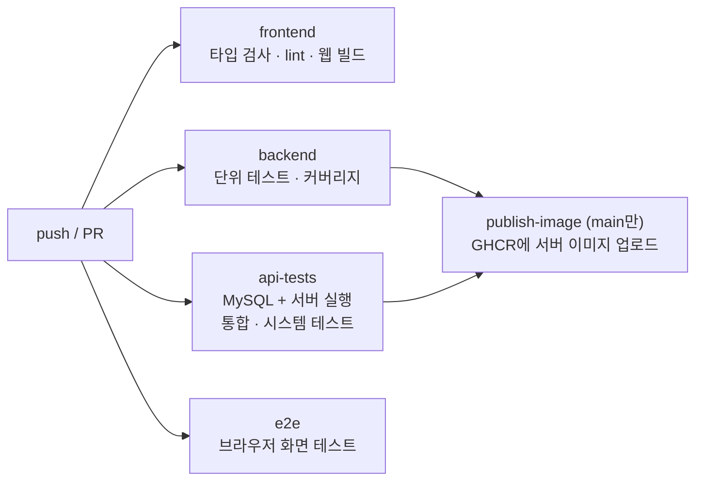

# CI/CD 파이프라인 구성

설정 파일: [`.github/workflows/ci.yml`](../../.github/workflows/ci.yml). Public 저장소의 표준 러너는 무료입니다.

## 실행 시점

| 이벤트 | 실행되는 작업 |
|---|---|
| Pull Request | `frontend`, `backend`, `api-tests`, `e2e` |
| `main`에 push | 위 작업 + 백엔드 테스트 통과 시 `publish-image` |



## 작업별 내용

| 작업 | 하는 일 | 결과물 |
|---|---|---|
| `frontend` | `npm ci` → `typecheck` → `lint` → `expo export` | - |
| `backend` | JDK 17로 `./gradlew test`, JaCoCo 커버리지 | artifact `backend-unit-reports` |
| `api-tests` | `docker compose up` 후 `integration_test.py`, `system_test.py` 실행 | artifact `api-test-results` |
| `e2e` | `docker compose up` 후 운영 웹 빌드를 Chrome으로 조작 (`npm run test:e2e`) | artifact `e2e-report` |
| `publish-image` | 서버 Docker 이미지 빌드·업로드 | `ghcr.io/kkssyy1215/bapmeokja-backend:latest`, `:커밋해시` |

`frontend`와 `e2e` 실패는 `publish-image`를 막지 않습니다. 이미지는 백엔드 테스트 결과에만 달려 있습니다.

## 시크릿

추가로 등록할 시크릿은 없습니다. 이미지 업로드는 GitHub가 자동 발급하는 `GITHUB_TOKEN`을 씁니다. CI에서는 `GEMINI_API_KEY`를 주지 않아서 시연용 분석기로 테스트하므로 외부 API 호출과 비용이 생기지 않습니다.

## 로컬에서 같은 검사 실행

```bash
docker compose up -d --build
```

```bash
npm run test:integration
```

```bash
npm run test:system
```

```bash
npm run test:exploratory
```

```bash
npm run test:e2e
```

```bash
cd backend && ./gradlew test
```
