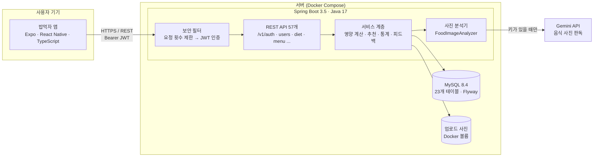
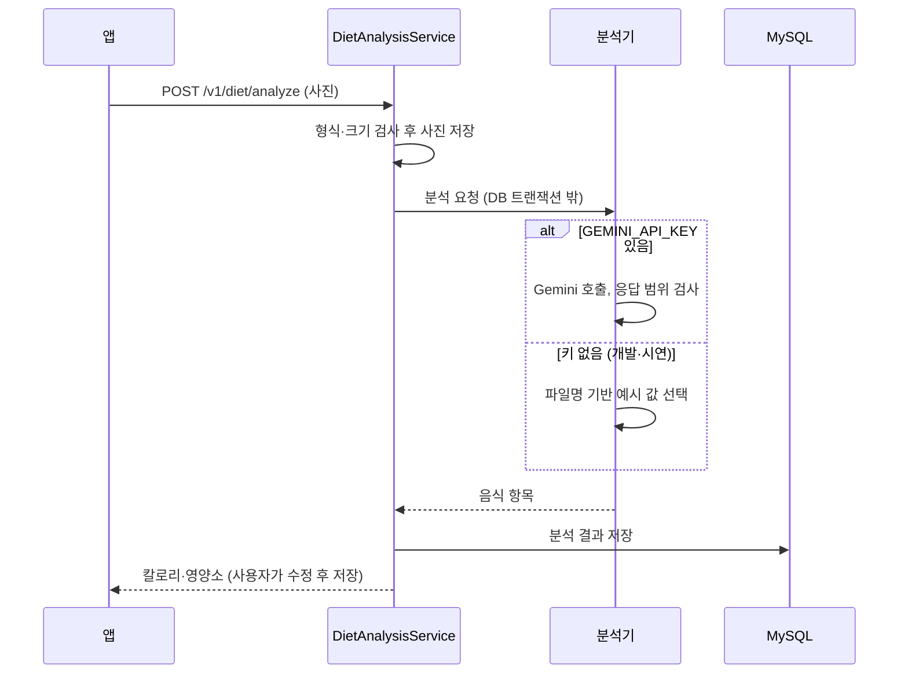

# 시스템 아키텍처 개략도

## 전체 구성

## 사진 분석 흐름

## 구성 요소

| 영역 | 기술 | 역할 |
|---|---|---|
| 앱 | Expo SDK 57, React Native 0.86, Axios | 화면, 토큰 재발급, 서버 호출 |
| API | Spring Boot 3.5, Spring Security, JPA | 인증, 식단, 통계, 추천, 냉장고, 커뮤니티 |
| 인증 | JWT, BCrypt | access/refresh 토큰, refresh 회전, 만료 토큰 매일 정리 |
| 보호 | 메모리 기반 요청 제한 | 로그인 대입과 AI 호출량 소진 방지 (IP별 분당 제한) |
| DB | MySQL 8.4, Flyway | 스키마 버전 관리, 초기 데이터 |
| AI | Gemini API | 사진 → 음식 항목·영양 추정. 키가 없으면 시연용 분석기 |
| 운영 | Docker Compose, GitHub Actions, GHCR | 실행 환경, 자동 테스트, 서버 이미지 |
